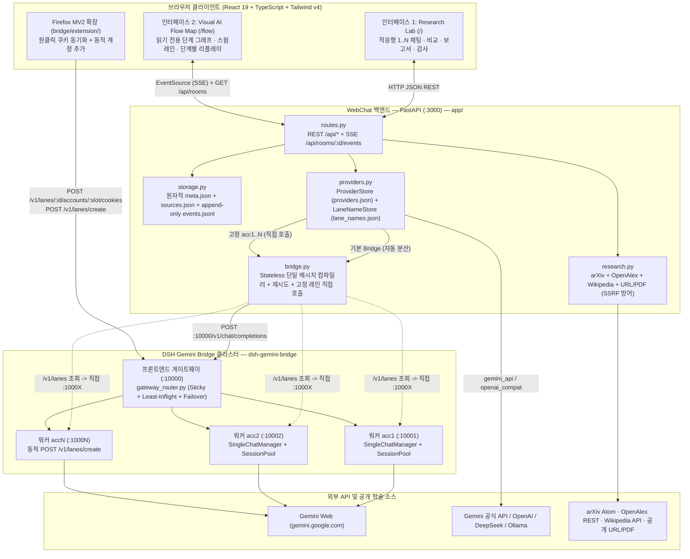
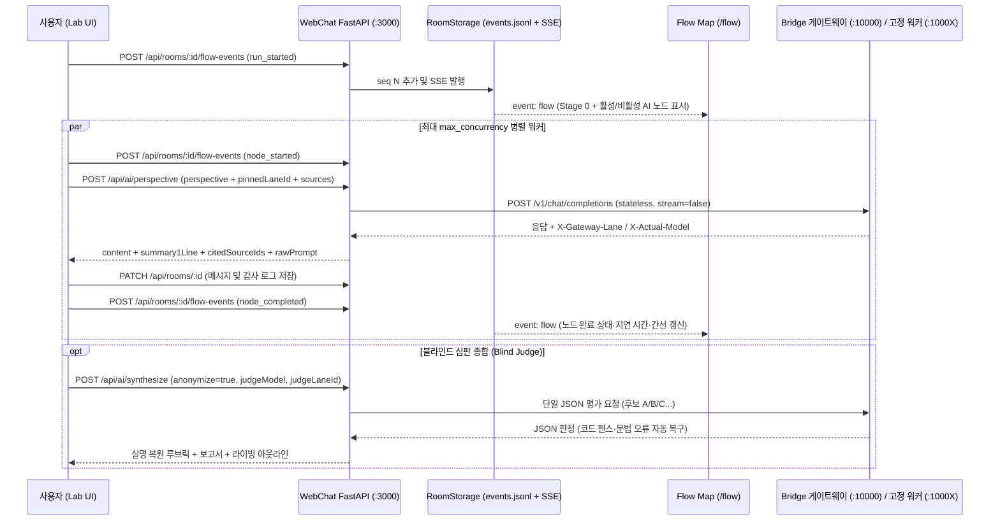

# 시스템 아키텍처 — Research AI Web

> 🌐 **언어:** [English](ARCHITECTURE.md) | **한국어** | [Tiếng Việt](ARCHITECTURE.vi.md)
>
> 📚 **관련 문서:** [README](../README.ko.md) · [알고리즘 및 참고 연구 논문](ALGORITHMS_AND_RESEARCH.ko.md)

본 문서는 **Research AI Web**의 실제 검증된 종단 간(End-to-End) 아키텍처를 설명합니다. 이중 인터페이스 React 프론트엔드, Python FastAPI 오케스트레이션 백엔드(`app/` & `src/`), 다중 계정 **DSH Gemini Bridge** 클러스터([dsh-gemini-bridge](https://github.com/Khai-1711/dsh-gemini-bridge)), 이벤트 소싱 저장소 및 보안 경계를 다룹니다.

---

## 1. 전체 시스템 토폴로지



---

## 2. 이중 인터페이스 제로 커플링 구조 (`src/`)

프론트엔드는 단일 Vite 번들(`dist/`)로 빌드되어 FastAPI(`app/main.py`)가 서빙하지만, 논리적으로는 완전히 분리된 두 화면(`App.tsx`)으로 동작합니다.

| 구분 | 인터페이스 1: Research Lab (`/`) | 인터페이스 2: Visual AI Flow Map (`/flow`) |
| :--- | :--- | :--- |
| **핵심 파일** | `src/lab/ResearchLabApp.tsx`, `GroupFeed.tsx`, `Composer.tsx`, `LeftDrawer.tsx`, `RightDrawer.tsx`, `SettingsDrawer.tsx`, `SecondaryViews.tsx` | `src/flow/FlowMapApp.tsx`, `FlowCanvasSvg.tsx`, `SwimlaneView.tsx` |
| **역할** | 작성 및 읽기: 1..N개 AI 질의, `@역할`/`@#태그` 호출, 교차 토론, 블라인드 심판, Deep Research, 비교, 보고서, 감사 | 순수 관찰(읽기 전용): 실시간/과거 실행 DAG 그래프, 수렴 버스, 워커별 간트 스윔레인, 단계별 리플레이 |
| **상태 동기화** | `PATCH /api/rooms/{id}`로 방 상태를 저장하고 `POST /api/rooms/{id}/flow-events`로 수명 주기 이벤트 발행 | 오직 `EventSource("/api/rooms/{id}/events")`의 `snapshot` 및 `flow` SSE 스트림만 구독 |
| **브라우저 저장소** | `localStorage`에는 **가벼운 UI 설정만 저장** (테마, 패널 열림 상태, 프리셋, 동시성/심판 설정) | `window.addEventListener("storage")`를 통해 탭 간 라이트/다크 테마 자동 동기화 |

---

## 3. WebChat 백엔드 아키텍처 (`app/`)

백엔드는 단일 책임 원칙을 따르는 7개 Python 모듈로 구성됩니다.

1. **`main.py`**: 앱 팩토리(`create_app`), `RoomStorage`·`BridgeClient`·`ProviderStore` 초기화, `dist/assets` 마운트 및 SPA 폴백(`/`·`/flow`) 처리.
2. **`config.py`**: `.env`에서 로드하는 불변 `Settings` dataclass(기본값 `PORT=3000`, `BRIDGE_URL=http://127.0.0.1:10000`, `DEFAULT_MODEL=gemini-4-hydrogen`, `BRIDGE_TIMEOUT_S=250.0`, `BRIDGE_MAX_RETRIES=2`).
3. **`storage.py` (`RoomStorage`)**:
   - 각 연구 방을 `data/rooms/<room_id>/` 디렉터리에 영구 저장:
     - `meta.json` (임시 파일 + `os.replace` 원자적 쓰기): 제목, AI 관점 목록, 메시지, 라이빙 아웃라인, 보고서, 감사 로그.
     - `sources.json` (원자적 쓰기): 검증된 `[S1]..[Sk]` 출처 레코드.
     - `events.jsonl` (append-only NDJSON): 단조 증가 `seq` 번호를 가진 실행 그래프 이벤트 로그.
   - 방(`room_id`)별 인메모리 `asyncio.Queue` 구독자 팬아웃과 20초 주기 `: ping` 하트비트로 실시간 SSE를 유지합니다.
   - 디스크에 방이 하나도 없을 때만 `ensure_default_room()`이 예시 대화 없는 깨끗한 빈 방(`room-default`) 1개를 생성합니다.
4. **`providers.py` (`ProviderStore` & `LaneNameStore`)**:
   - 기본 내장 `bridge-local`과 사용자가 추가한 `bridge`, `gemini_api`, `openai_compat` 공급자를 `data/providers.json`에 관리합니다.
   - 모든 공개 API 응답에서 API 키를 마스킹(`mask_secret`: `AIza...9x2Q`)합니다.
   - `GET :10000/v1/models`에서 Bridge의 실제 가용 모델을 실시간 조회하여 커스텀 공급자 모델과 병합(`GET /api/models`)합니다.
   - 사용자가 지정한 Bridge 계정 별칭(`acc1`, `acc2`, `acc3`, …)은 민감한 `.env.acc*` 쿠키 파일을 건드리지 않고 별도의 `data/lane_names.json`에 저장합니다.
5. **`bridge.py` (`BridgeClient`)**:
   - **Stateless 단일 사용자 메시지 컴파일 (`compile_stateless_user_prompt`)**: Gemini Web이 `role: "system"`을 무시하는 특성과 Gateway의 `429`/`503` 페일오버를 유지하기 위해 시스템 지시와 사용자 질문을 단일 `role: "user"` 메시지로 병합하고 `stream: false`로 호출합니다.
   - **이중 라우팅 모드**:
     - *자동 분산(`pinned_lane_id` 미지정)*: Gateway `:10000/v1/chat/completions`로 전송하고 `X-Gateway-Lane`, `X-Actual-Model`, `X-Fallback-From` 헤더를 읽습니다.
     - *고정 계정 직접 호출(`pinned_lane_id = "accX"`)*: Gateway `GET /v1/lanes`에서 `accX`의 로컬 주소를 조회하고 `_is_loopback_url()`로 검증합니다. 고정된 계정이 OFF이거나 응답 불가일 경우 다른 계정으로 몰래 우회하지 않고 명시적 오류(`HTTP 502`)를 반환하며, 정상 시 `http://127.0.0.1:1000X/v1/chat/completions`로 직접 전송합니다.
   - **복원력 있는 재시도 및 모델 폴백**: `{408, 429, 500, 502, 503, 504}`에 대해 `Retry-After`를 존중하는 지수 백오프를 수행하고, `400 model_not_available` 발생 시 `"auto"`로 자동 폴백합니다.
6. **`research.py`**: arXiv Atom XML, OpenAlex Works API(역인덱스 초록 복원 포함), Wikipedia Search API 병렬 검색(`asyncio.gather`) 및 SSRF 방어 기반 URL/PDF 추출(`pypdf`, 최대 5MB, 앞 4페이지).
7. **`routes.py`**: REST/SSE 라우터, 관점별 프롬프트 조립, `[S#]` 인용 화이트리스트 필터링, 블라인드 심판 종합 및 별칭 복원.

---

## 4. 종단 간 요청 및 이벤트 데이터 흐름



---

## 5. DSH Gemini Bridge 클러스터 ([dsh-gemini-bridge](https://github.com/Khai-1711/dsh-gemini-bridge))

Bridge 서브시스템은 인증된 Gemini Web 세션을 OpenAI 호환 멀티 워커 API 클러스터로 변환합니다.

- **프론트엔드 게이트웨이 (`bridge/main.py`, `app/gateway_router.py`)**:
  - 포트 `10000`에서 `PEER_LANES`(`acc1=http://127.0.0.1:10001`, `acc2=…`, `acc3=…`)가 설정되면 자동 활성화됩니다.
  - 정상 워커들의 `/v1/models`를 합집합으로 병합해 제공하고, `/v1/chat/completions` 요청을 Sticky + Least-Inflight 정책 및 `15s` 쿨다운 페일오버로 중계합니다.
  - 루프백 전용 `POST /v1/lanes/create`(`_create_lane_lock`)를 통해 `.env.accN` 생성, `PEER_LANES` 갱신, 워커 프로세스 기동 및 준비 상태 확인까지 자동화합니다.
- **워커 런타임 (`app/gemini_runtime.py`, `app/session_pool.py`, `app/account_pool.py`, `app/gemini_session.py`)**:
  - **자기 교착(Self-Deadlock) 방지 `GeminiClient` 서브클래스 (`app/gemini_session.py`)**: RPC 호출 전에 Google 로그인 리다이렉트(`boq_identityfrontendauthuiserver`)를 조기 감지하고, `init()` 내부에서 재귀적 `@running` 재시도를 비활성화(`current_retry=0, close_on_error=False`)하여 `self._lock` 교착을 근본 차단하며, 오염된 쿠키 캐시 정리 및 프리플라이트 쿠키 프로브를 수행합니다.
  - **보조 쿠키 영속화**: 전체 브라우저 쿠키(`SID`, `HSID`, `SSID`, `__Secure-1PSIDCC` 등)를 `.gemini_cookies_acc*/extra_cookies_slot{slot}.json`에 저장하여 서버 재시작 후에도 로그인 상태를 유지합니다.
  - **Windows 이벤트 루프 보호 (`bridge/main.py`)**: Windows에서 `curl_cffi`(`add_reader`/`add_writer`)가 `ProactorEventLoop`와 충돌하는 문제를 막기 위해 `asyncio.SelectorEventLoop`를 명시적으로 사용합니다.
  - **세션 풀 & 툴 파서**: 최대 16개 동시 세션 슬롯을 격리(`SESSION_POOL_TTL=3600s`)하고, 코딩 에이전트 사용 시 Fail-Closed `<tool_call>` 파싱을 적용합니다.

---

## 6. 이벤트 그래프 계약 (`events.jsonl`)

모든 방의 `events.jsonl`은 명시적 DAG 입력 간선(`inputs[]`)을 가진 NDJSON 레코드를 기록하므로 `/flow`는 특정 워크플로우를 하드코딩하지 않고 모든 실행 흐름을 그대로 시각화합니다.

```json
{
  "seq": 4,
  "event_type": "node_completed",
  "run_id": "run-1795276408523",
  "room_id": "room-1795276408523",
  "timestamp": "2026-11-21T15:53:58.695Z",
  "payload": {
    "node_id": "stage1_p-research-1_run-1795276408523",
    "stage_index": 1,
    "stage_label": "Round 0 · Independent (1)",
    "actor": { "id": "p-research-1", "handle": "Nghiên_cứu", "kind": "ai", "enabled": true },
    "inputs": [
      { "from_node_id": "stage0_user_run-1795276408523", "kind": "prompt", "chars": 13, "source_ids": [] }
    ],
    "summary_1line": "...",
    "transport": { "lane_id": "acc1", "started_offset_s": 0.1, "elapsed_s": 14.0 }
  }
}
```

---

## 7. 보안 경계 (Security Boundaries)

1. **비밀 정보 분리:** 쿠키는 `bridge/.env.acc*` 및 `bridge/.gemini_cookies_acc*/`에만, 커스텀 API 키는 `data/providers.json`에만 저장되며 Git 커밋 및 평문 로깅이 차단됩니다.
2. **SSRF 완화 (`app/research.py`):** 비-HTTP(S) 스킴, 루프백·사설·링크로컬 IP 및 `.local`/`.internal` 호스트를 차단하며, DNS 조회 검증과 함께 `follow_redirects=False` 상태에서 `Location` 리다이렉트 대상을 재검증합니다.
3. **Origin 및 루프백 가드 (`bridge/app/control.py`, `bridge/app/lane_security.py`, `app/bridge.py`):** 제어 API의 `Host`/`Origin` 헤더를 검사하고, 확장 프로그램 출처는 루프백 바인딩에서만 허용하며, 고정 레인 직접 호출은 루프백 URL로만 제한합니다.
4. **Fail-Closed 고정 라우팅:** 비활성 또는 응답 불가 계정에 고정된 AI 요청은 다른 Google 계정으로 임의 우회하지 않고 명시적 `HTTP 502` 오류를 반환합니다.
