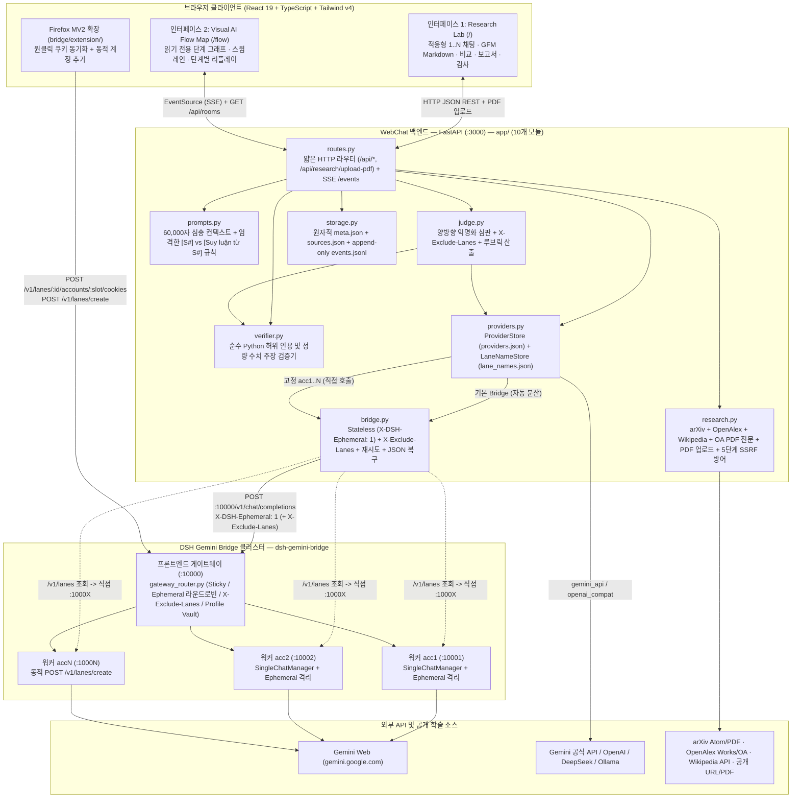
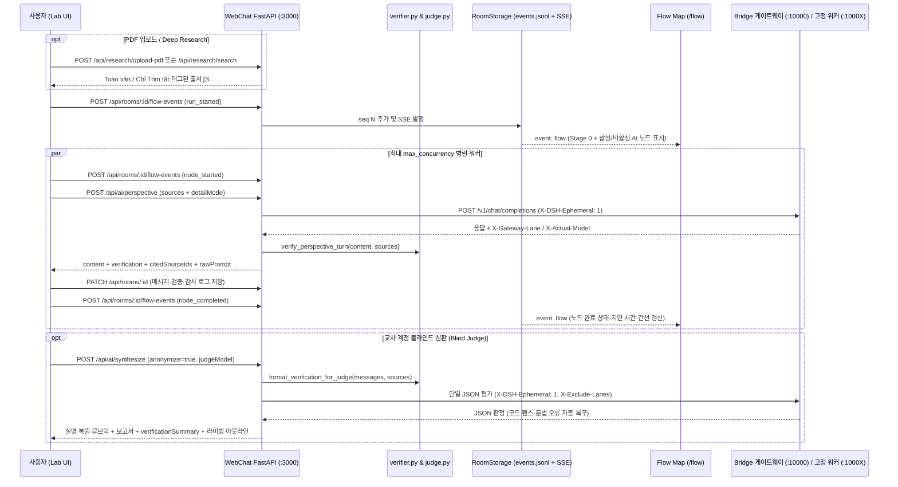

# 시스템 아키텍처 — Research AI Web

> 🌐 **언어:** [English](ARCHITECTURE.md) | **한국어** | [Tiếng Việt](ARCHITECTURE.vi.md)
>
> 📚 **관련 문서:** [README](../README.ko.md) · [알고리즘 및 참고 연구 논문](ALGORITHMS_AND_RESEARCH.ko.md)

본 문서는 **Research AI Web**의 실제 검증된 종단 간(End-to-End) 아키텍처를 설명합니다. 이중 인터페이스 React 프론트엔드(`src/`), 단일 책임 원칙을 따르는 10개 Python FastAPI 백엔드 모듈(`app/`), 다중 계정 **DSH Gemini Bridge** 클러스터([dsh-gemini-bridge](https://github.com/Khai-1711/dsh-gemini-bridge)), 결정론적 인용·수치 검증기, 이벤트 소싱 저장소(`events.jsonl` + SSE) 및 보안 경계를 다룹니다.

---

## 1. 전체 시스템 토폴로지



---

## 2. 이중 인터페이스 제로 커플링 구조 (`src/`)

프론트엔드는 단일 Vite 번들(`dist/`)로 빌드되어 FastAPI(`app/main.py`)가 서빙하지만, 논리적으로는 완전히 분리된 두 화면(`App.tsx`)으로 동작합니다.

| 구분 | 인터페이스 1: Research Lab (`/`) | 인터페이스 2: Visual AI Flow Map (`/flow`) |
| :--- | :--- | :--- |
| **핵심 파일** | `src/lab/ResearchLabApp.tsx`, `GroupFeed.tsx`, `MarkdownText.tsx`, `Composer.tsx`, `LeftDrawer.tsx`, `RightDrawer.tsx`, `SettingsDrawer.tsx`, `SecondaryViews.tsx` | `src/flow/FlowMapApp.tsx`, `FlowCanvasSvg.tsx`, `SwimlaneView.tsx` |
| **역할** | 작성 및 읽기: 1..N개 AI 질의, `@역할`/`@#태그` 호출, 로컬 PDF 업로드, Deep Research, 교차 토론, 블라인드 심판, 비교, 보고서, 감사 | 순수 관찰(읽기 전용): 실시간/과거 실행 DAG 그래프, 수렴 버스, 워커별 간트 스윔레인, 단계별 리플레이 |
| **상태 동기화** | `PATCH /api/rooms/{id}`로 방 상태를 저장하고 `POST /api/rooms/{id}/flow-events`로 수명 주기 이벤트 발행 | 오직 `EventSource("/api/rooms/{id}/events")`의 `snapshot` 및 `flow` SSE 스트림만 구독 |
| **브라우저 저장소** | `localStorage`에는 **가벼운 UI 설정만 저장** (테마, 패널 열림 상태, 프리셋, 동시성/심판 설정) | `window.addEventListener("storage")`를 통해 탭 간 라이트/다크 테마 자동 동기화 |

---

## 3. WebChat 백엔드 아키텍처 (`app/` — 10개 단일 책임 모듈)

백엔드는 역할별로 명확히 분리된 10개의 Python 모듈로 구성됩니다.

1. **`main.py`**: 앱 팩토리(`create_app`), `RoomStorage`·`BridgeClient`·`ProviderStore` 초기화, `dist/assets` 마운트 및 SPA 폴백(`/`·`/flow`) 처리.
2. **`config.py`**: `.env`에서 로드하는 불변 `Settings` dataclass(기본값 `PORT=3000`, `BRIDGE_URL=http://127.0.0.1:10000`, `DEFAULT_MODEL=gemini-4-hydrogen`, `BRIDGE_TIMEOUT_S=250.0`, `BRIDGE_MAX_RETRIES=2`).
3. **`storage.py` (`RoomStorage`)**:
   - 각 연구 방을 `data/rooms/<room_id>/`에 영구 저장 (`meta.json` 원자적 쓰기, `sources.json`, `events.jsonl` append-only NDJSON).
   - 방별 인메모리 `asyncio.Queue` 구독자 팬아웃과 20초 주기 `: ping` 하트비트로 실시간 SSE를 유지하고, 빈 저장소에서는 깨끗한 빈 방(`room-default`) 1개만 생성합니다.
4. **`providers.py` (`ProviderStore` & `LaneNameStore`)**:
   - 기본 `bridge-local` 및 사용자 추가 `bridge`·`gemini_api`·`openai_compat` 공급자를 `data/providers.json`에 관리하고 모든 API 키를 마스킹(`AIza...9x2Q`)합니다.
   - `exclude_lanes` 인자를 `BridgeClient.chat_stateless`로 전달하며 계정 별칭(`acc1..accN`)을 `data/lane_names.json`에 저장합니다.
5. **`bridge.py` (`BridgeClient`)**:
   - **무상태 격리 호출 (`X-DSH-Ephemeral: 1`)**: `system_instruction`과 `user_prompt`를 단일 `role: "user"` 메시지로 컴파일하고 `X-DSH-Ephemeral: 1`(워커의 영구 세션·모델 기본값·핸드오프 원장 비오염) 및 선택적 `X-Exclude-Lanes`(심판 교차 계정 라우팅)를 전송합니다.
   - **이중 라우팅 모드**: Gateway `:10000` 자동 분산(`X-Gateway-Lane`/`X-Actual-Model`/`X-Fallback-From` 수신) 또는 고정 계정 Fail-Closed 루프백 직접 호출(`pinned_lane_id`, 비활성 시 `HTTP 502` 반환).
   - **Profile Vault 프록시 & 복원력**: 동적 워커 생성(`/v1/lanes/create`) 및 로그인/동기화 프록시, `Retry-After` 존중 지수 백오프(`{408, 429, 500, 502, 503, 504}`), `parse_resilient_json` 복구 기능을 제공합니다.
6. **`research.py`**:
   - arXiv Atom XML, OpenAlex Works API(역인덱스 초록 복원), Wikipedia Search API를 병렬 조회(`asyncio.gather`)하고 상위 3개 오픈 액세스 논문을 **PDF 전문**(`pypdf`, 최대 20페이지, `MAX_FULLTEXT_EXCERPT_LEN = 16000`)으로 자동 업그레이드합니다.
   - 로컬 PDF 업로드 추출(`extract_uploaded_pdf_source`, 최대 `15MB`, `25`페이지) 및 `_safe_get_following_redirects`를 통한 5단계 리다이렉트 SSRF 방어를 수행하며 `contentLevel`(`full_text` | `abstract_only` | `excerpt`)을 부여합니다.
7. **`prompts.py`**:
   - 표준 모드(`MAX_HISTORY_CHARS = 8000`, `MAX_PERSPECTIVE_SOURCE_CHARS = 3000`) 및 심층 모드(`MAX_DEEP_HISTORY_CHARS = 60000`, `MAX_PRESERVED_RESEARCH_CHARS = 16000`, `MAX_PERSPECTIVE_SOURCE_CHARS_DEEP = 12000`) 컨텍스트 예산을 제어합니다.
   - `[S#]`(원문 직접 근거)와 `[Suy luận từ S#]`(추론·계산) 분리 규칙 및 출처 깊이 태그(`[TOÀN VĂN]` / `[CHỈ CÓ TÓM TẮT (ABSTRACT)]`)를 강제합니다.
8. **`verifier.py`**:
   - 순수 Python 결정론적 검증기(`verify_perspective_turn`, `format_verification_for_judge`)로 `validCitations`, `inferredCitations`, `invalidCitations`(조작 ID), `abstractOnlyCited`, 그리고 `[S#]` 문장 내 수치 주장(`%`, 소수점, 표본 수 `n=...`)과 원문 간 정합성을 검사합니다.
9. **`judge.py`**:
   - 양방향 익명화(`@handle ↔ Ứng viên A/B/C…`), 토론 참여 `used_lanes` 수집 후 `X-Exclude-Lanes` 전달, 출처 발췌(`MAX_JUDGE_SOURCE_EXCERPT = 6000`)와 `verifier.py` 감사 보고서 결합, 3축 루브릭 점수 산출 및 불완전 JSON 시 `fallbackScored` 경고를 처리합니다.
10. **`routes.py`**: `/api/health`, `/api/lanes/*`, `/api/providers/*`, `/api/models`, `/api/rooms/*`, `/api/research/search`, `/api/research/upload-pdf`(`application/pdf` 바이트 또는 JSON `contentBase64`), `/api/ai/perspective`, `/api/ai/synthesize`를 제공하는 얇은 라우터입니다.

---

## 4. 종단 간 요청 및 이벤트 데이터 흐름



---

## 5. DSH Gemini Bridge 클러스터 ([dsh-gemini-bridge](https://github.com/Khai-1711/dsh-gemini-bridge))

연동 Bridge 서브시스템은 인증된 Gemini Web 세션을 OpenAI 호환 멀티 워커 API 클러스터로 제공합니다.

- **프론트엔드 게이트웨이 (`bridge/main.py`, `app/gateway_router.py`)**: 일반 대화에는 Sticky + Least-Inflight 정책을 유지하고, `X-DSH-Ephemeral: 1` 요청에는 `X-Exclude-Lanes` 회피를 지원하는 공정 라운드로빈 분산을 수행하며 `15s` 쿨다운 페일오버와 Profile Vault 프록시를 제공합니다.
- **워커 런타임 (`app/gemini_runtime.py`, `app/session_pool.py`, `app/account_pool.py`, `app/gemini_session.py`, `app/streaming.py`)**:
  - `X-DSH-Ephemeral: 1` 턴은 임시 세션으로 완전 격리되어 영구 `chat_session`, `FactLedger`, `default_model`, 핸드오프 상태에 전혀 영향을 주지 않습니다.
  - 자기 교착 방지 `GeminiClient.init()` 서브클래스와 스트리밍 UI 마크업 필터(`streaming.py`: `<tool_call>` JSON은 보존하고 내부 `<ElicitationsGroup>`/`<Elicitation>` XML 제거)를 제공합니다.

---

## 6. 이벤트 그래프 계약 (`events.jsonl`)

모든 방의 `events.jsonl`은 명시적 DAG 입력 간선(`inputs[]`)을 가진 NDJSON 레코드를 기록하므로 `/flow`는 특정 워크플로우를 하드코딩하지 않고 모든 실행 흐름을 그대로 시각화합니다.

```json
{
  "seq": 4,
  "event_type": "node_completed",
  "run_id": "run-1795276408523",
  "room_id": "room-1795276408523",
  "timestamp": "2026-11-21T15:53:58.695Z",
  "payload": {
    "node_id": "stage1_p-research-1_run-1795276408523",
    "stage_index": 1,
    "stage_label": "Round 0 · Independent (1)",
    "actor": { "id": "p-research-1", "handle": "Nghiên_cứu", "kind": "ai", "enabled": true },
    "inputs": [
      { "from_node_id": "stage0_user_run-1795276408523", "kind": "prompt", "chars": 13, "source_ids": [] }
    ],
    "summary_1line": "...",
    "transport": { "lane_id": "acc1", "started_offset_s": 0.1, "elapsed_s": 14.0 }
  }
}
```

---

## 7. 보안 경계 (Security Boundaries)

1. **비밀 정보 분리:** 쿠키는 `bridge/.env.acc*` 및 `bridge/.gemini_cookies_acc*/`에만, 커스텀 API 키는 `data/providers.json`에만 저장되며 Git 커밋 및 평문 로깅이 차단됩니다.
2. **5단계 SSRF 완화 (`app/research.py`):** 비-HTTP(S) 스킴, 루프백·사설·링크로컬 IP 및 `.local`/`.internal` 호스트를 차단하며, DNS 검증과 함께 `follow_redirects=False` 상태에서 최대 5단계 `Location` 리다이렉트 대상을 재검증합니다.
3. **안전한 로컬 PDF 업로드 (`app/routes.py`, `app/research.py`):** `15MB` 상한과 `%PDF-` 서명을 검증하고 텍스트 레이어 없는 스캔 PDF를 거부합니다.
4. **Origin 및 루프백 가드 (`bridge/app/control.py`, `bridge/app/lane_security.py`, `app/bridge.py`):** 제어 API의 `Host`/`Origin` 헤더를 검사하고 고정 레인 직접 호출을 루프백 URL로 제한합니다.
5. **Fail-Closed 고정 라우팅:** 비활성 또는 응답 불가 계정에 고정된 AI 요청은 다른 Google 계정으로 우회하지 않고 명시적 `HTTP 502` 오류를 반환합니다.
