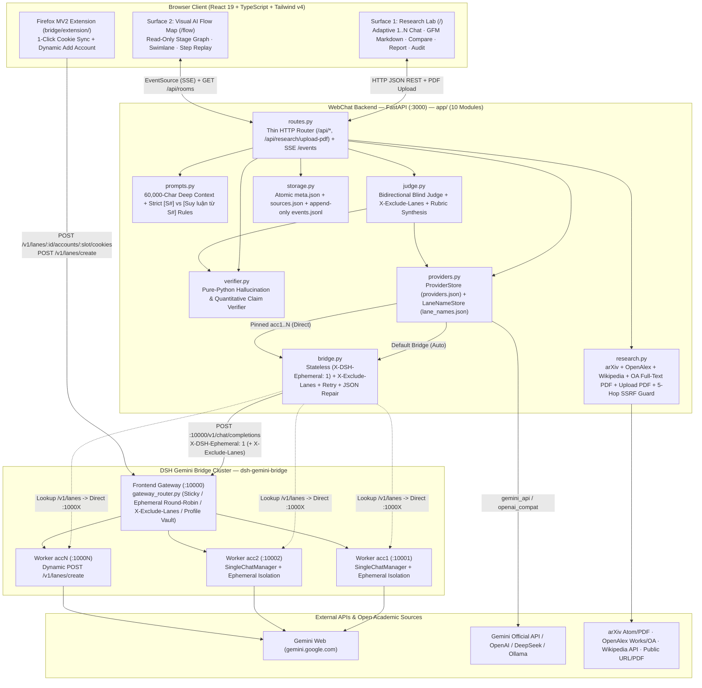
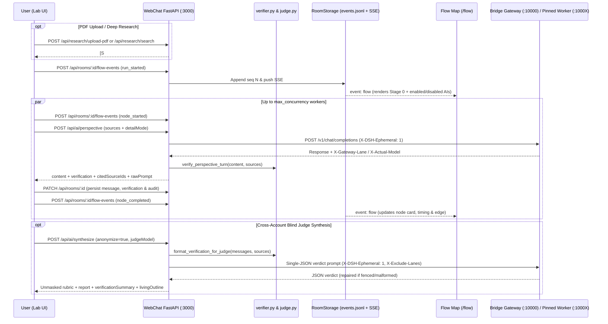

# System Architecture — Research AI Web

> 🌐 **Language:** **English** | [한국어](ARCHITECTURE.ko.md) | [Tiếng Việt](ARCHITECTURE.vi.md)
>
> 📚 **Related Docs:** [README](../README.md) · [Algorithms & Research References](ALGORITHMS_AND_RESEARCH.md)

This document details the verified end-to-end architecture of **Research AI Web**, spanning the dual-surface React frontend (`src/`), the 10 single-responsibility Python FastAPI modules (`app/`), the companion multi-account **DSH Gemini Bridge** cluster ([dsh-gemini-bridge](https://github.com/Khai-1711/dsh-gemini-bridge)), deterministic citation/numeric verification, event-sourced storage (`events.jsonl` + SSE), and security boundaries.

---

## 1. High-Level Topology



---

## 2. Two-Surface Zero-Coupling Frontend (`src/`)

The frontend is built as a single Vite bundle (`dist/`) served by FastAPI (`app/main.py`), while enforcing strict logical separation between two independent views (`App.tsx`):

| Aspect | Surface 1: Research Lab (`/`) | Surface 2: Visual AI Flow Map (`/flow`) |
| :--- | :--- | :--- |
| **Primary Files** | `src/lab/ResearchLabApp.tsx`, `GroupFeed.tsx`, `MarkdownText.tsx`, `Composer.tsx`, `LeftDrawer.tsx`, `RightDrawer.tsx`, `SettingsDrawer.tsx`, `SecondaryViews.tsx` | `src/flow/FlowMapApp.tsx`, `FlowCanvasSvg.tsx`, `SwimlaneView.tsx` |
| **Role** | Authoring & reading: ask 1..N AIs, mention `@role`/`@#tag`, upload local PDFs, run Deep Research, Cross-Debate, Blind Judge, Compare, Report, Audit | Pure observation (read-only): visualize live/historical execution graph, convergence bus, per-worker Gantt swimlanes, step replay |
| **State Synchronization** | Writes room state via `PATCH /api/rooms/{id}` and emits lifecycle events via `POST /api/rooms/{id}/flow-events` | Subscribes exclusively via `EventSource("/api/rooms/{id}/events")` (`snapshot` + `flow` SSE events) |
| **Browser Storage** | `localStorage` stores **only lightweight UI preferences**: theme (`light`/`dark`), drawer open/closed flags, custom presets, and concurrency/judge settings | Synchronizes theme across tabs via `window.addEventListener("storage")` |

---

## 3. WebChat Backend Architecture (`app/` — 10 Single-Responsibility Modules)

The backend is modularized into 10 decoupled Python modules for maintainability and deterministic unit testing:

1. **`main.py`**: App factory (`create_app`), wires `RoomStorage`, `BridgeClient`, `ProviderStore`, mounts `/assets` from `dist/`, and provides SPA fallback routing (`/` and `/flow`).
2. **`config.py`**: Typed `Settings` dataclass loaded from `.env` (default `PORT=3000`, `BRIDGE_URL=http://127.0.0.1:10000`, `DEFAULT_MODEL=gemini-4-hydrogen`, `BRIDGE_TIMEOUT_S=250.0`, `BRIDGE_MAX_RETRIES=2`).
3. **`storage.py` (`RoomStorage`)**:
   - Persists each room under `data/rooms/<room_id>/`: `meta.json` (atomic temp-file + `os.replace`), `sources.json` (verified `[S1]..[Sk]` evidence), and `events.jsonl` (append-only NDJSON with monotonic `seq`).
   - Maintains in-memory `asyncio.Queue` fan-out subscribers per `room_id` to push live SSE frames with 20s `: ping` heartbeats.
   - Creates a single clean empty room (`room-default`) via `ensure_default_room()` when `data/rooms/` is empty.
4. **`providers.py` (`ProviderStore` & `LaneNameStore`)**:
   - Manages builtin `bridge-local` and user-added `bridge`, `gemini_api`, and `openai_compat` providers in `data/providers.json`; masks all API keys (`AIza...9x2Q`) before returning public responses.
   - Forwards `exclude_lanes` to `BridgeClient.chat_stateless`; persists custom `acc1..accN` display names in `data/lane_names.json`.
5. **`bridge.py` (`BridgeClient`)**:
   - **Stateless Ephemeral Compilation (`X-DSH-Ephemeral: 1`)**: Merges `system_instruction` + `user_prompt` into a single `role: "user"` message with `X-DSH-Ephemeral: 1` (preventing Bridge workers from mutating persistent sessions, default models, transcripts, or coding handoff ledgers) and optional `X-Exclude-Lanes` (for cross-account Judge routing).
   - **Two Routing Modes**: Automatic load balancing via Gateway `:10000` (reading `X-Gateway-Lane`, `X-Actual-Model`, `X-Fallback-From`), or direct fail-closed loopback routing for pinned lanes (`pinned_lane_id = "accX"`, returning `HTTP 502` if OFF/unreachable).
   - **Profile Vault Proxy & Fault Tolerance**: Proxies dynamic lane creation (`/v1/lanes/create`) and Profile Vault login/sync (`/login`, `/finish-login`, `/sync`, `/sync-all`); applies exponential backoff respecting `Retry-After` on `{408, 429, 500, 502, 503, 504}` and repairs fenced/malformed JSON via `parse_resilient_json`.
6. **`research.py`**:
   - Parallel retrieval (`asyncio.gather`) across arXiv Atom XML, OpenAlex Works API (reconstructing inverted-index abstracts), and Wikipedia Search API, automatically upgrading up to 3 open-access arXiv/OpenAlex candidates to **Full-Text PDF** (`pypdf`, up to 20 pages, `MAX_FULLTEXT_EXCERPT_LEN = 16000`).
   - Supports local PDF uploads (`extract_uploaded_pdf_source`, 15 MB cap, 25 pages) and SSRF-guarded URL fetching via `_safe_get_following_redirects` (validating public IPs before DNS resolution and on up to 5 HTTP `Location` redirects).
   - Tags every source honestly with `contentLevel` (`full_text` | `abstract_only` | `excerpt`) and `charCount`.
7. **`prompts.py`**:
   - Enforces context budgets (`MAX_HISTORY_CHARS = 8000` / `MAX_PERSPECTIVE_SOURCE_CHARS = 3000` in standard mode; `MAX_DEEP_HISTORY_CHARS = 60000` / `MAX_PRESERVED_RESEARCH_CHARS = 16000` / `MAX_PERSPECTIVE_SOURCE_CHARS_DEEP = 12000` in deep mode).
   - Enforces strict separation between `[S#]` direct citations and `[Suy luận từ S#]` model inferences while annotating each source with `[TOÀN VĂN]` or `[CHỈ CÓ TÓM TẮT (ABSTRACT)]`.
8. **`verifier.py`**:
   - Deterministic pure-Python verification (`verify_perspective_turn`, `format_verification_for_judge`): classifies `validCitations`, `inferredCitations`, `invalidCitations` (hallucinated IDs), `abstractOnlyCited`, and matches quantitative numeric claims (`%`, decimals, sample sizes `n=...`) inside `[S#]` sentences directly against source text.
9. **`judge.py`**:
   - Builds bidirectional identity masking (`@handle ↔ Ứng viên A/B/C…`), collects debaters' `used_lanes` to forward `X-Exclude-Lanes`, injects the `verifier.py` audit report alongside up to `MAX_JUDGE_SOURCE_EXCERPT = 6000` chars per source, computes 3-axis Rubric totals, and flags `fallbackScored` if Judge returns incomplete JSON scores.
10. **`routes.py`**: Thin HTTP router exposing `/api/health`, `/api/lanes/*`, `/api/providers/*`, `/api/models`, `/api/rooms/*`, `/api/research/search`, `/api/research/upload-pdf` (raw `application/pdf` or JSON `contentBase64`), `/api/ai/perspective`, and `/api/ai/synthesize`, while re-exporting helper symbols for backward compatibility.

---

## 4. End-to-End Request & Event Data Flow



---

## 5. DSH Gemini Bridge Cluster ([dsh-gemini-bridge](https://github.com/Khai-1711/dsh-gemini-bridge))

The companion Bridge subsystem turns authenticated Gemini Web sessions into an OpenAI-compatible multi-worker cluster:

- **Frontend Gateway (`bridge/main.py`, `app/gateway_router.py`)**: Routes sticky sessions with Least-Inflight selection, switches to fair Round-Robin for `X-DSH-Ephemeral: 1` requests while avoiding `X-Exclude-Lanes` whenever healthy alternatives exist, applies `15s` failure cooldowns, and exposes local Profile Vault / dynamic lane management endpoints.
- **Worker Runtime (`app/gemini_runtime.py`, `app/session_pool.py`, `app/account_pool.py`, `app/gemini_session.py`, `app/streaming.py`)**:
  - Fully isolates `X-DSH-Ephemeral: 1` turns (fresh transient session, no persistent ledger mutation, no model override leakage, no `[GOAL]`/handoff wrapping, no forced replay fallback).
  - Self-deadlock-safe `GeminiClient.init()` subclass and streaming UI tag sanitizer (`streaming.py`) removing internal `<ElicitationsGroup>`/`<Elicitation>` markup while preserving `<tool_call>` JSON payloads.

---

## 6. Event Graph Contract (`events.jsonl`)

Every room's `events.jsonl` stores newline-delimited JSON objects with explicit DAG edges (`inputs[]`), keeping `/flow` scenario-agnostic:

```json
{
  "seq": 4,
  "event_type": "node_completed",
  "run_id": "run-1795276408523",
  "room_id": "room-1795276408523",
  "timestamp": "2026-11-21T15:53:58.695Z",
  "payload": {
    "node_id": "stage1_p-research-1_run-1795276408523",
    "stage_index": 1,
    "stage_label": "Round 0 · Independent (1)",
    "actor": { "id": "p-research-1", "handle": "Nghiên_cứu", "kind": "ai", "enabled": true },
    "inputs": [
      { "from_node_id": "stage0_user_run-1795276408523", "kind": "prompt", "chars": 13, "source_ids": [] }
    ],
    "summary_1line": "...",
    "transport": { "lane_id": "acc1", "started_offset_s": 0.1, "elapsed_s": 14.0 }
  }
}
```

---

## 7. Security Boundaries

1. **Secret Separation**: Cookies live only in `bridge/.env.acc*` and `bridge/.gemini_cookies_acc*/`; custom API keys live only in `data/providers.json`. None are committed to Git or logged in plaintext.
2. **5-Hop SSRF Mitigation (`app/research.py`)**: Rejects non-HTTP(S) schemes, localhost/private/link-local IPs, `.local`/`.internal` hostnames, resolves DNS before fetch, disables implicit redirects (`follow_redirects=False`), and re-validates every `Location` hop (up to 5 hops).
3. **Bounded Local PDF Upload (`app/routes.py`, `app/research.py`)**: Enforces a `15 MB` cap and `%PDF-` header check, rejecting scanned image-only PDFs lacking selectable text.
4. **Origin & Loopback Guards (`bridge/app/control.py`, `bridge/app/lane_security.py`, `app/bridge.py`)**: Validates `Host`/`Origin` headers on Bridge control endpoints and restricts pinned-lane forwarding strictly to loopback URLs.
5. **Fail-Closed Pinned Routing**: Pinning an AI to an inactive/unreachable Bridge lane returns an explicit `HTTP 502` rather than silently substituting a different Google account.
