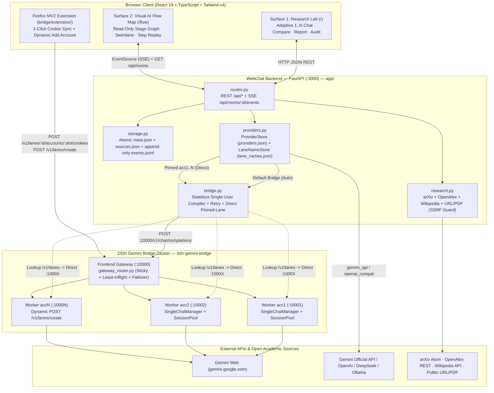
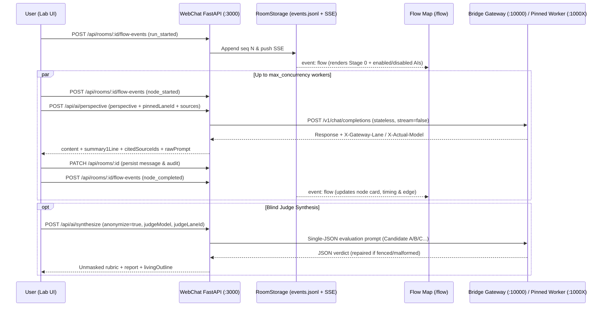

# System Architecture — Research AI Web

> 🌐 **Language:** **English** | [한국어](ARCHITECTURE.ko.md) | [Tiếng Việt](ARCHITECTURE.vi.md)
>
> 📚 **Related Docs:** [README](../README.md) · [Algorithms & Research References](ALGORITHMS_AND_RESEARCH.md)

This document details the verified end-to-end architecture of **Research AI Web**, spanning the dual-surface React frontend, the Python FastAPI orchestration backend (`app/` & `src/`), the multi-account **DSH Gemini Bridge** cluster ([dsh-gemini-bridge](https://github.com/Khai-1711/dsh-gemini-bridge)), event-sourced storage, and security boundaries.

---

## 1. High-Level Topology



---

## 2. Two-Surface Zero-Coupling Frontend (`src/`)

The frontend is built as a single Vite bundle (`dist/`) served by FastAPI (`app/main.py`), while enforcing strict logical separation between two independent views (`App.tsx`):

| Aspect | Surface 1: Research Lab (`/`) | Surface 2: Visual AI Flow Map (`/flow`) |
| :--- | :--- | :--- |
| **Primary Files** | `src/lab/ResearchLabApp.tsx`, `GroupFeed.tsx`, `Composer.tsx`, `LeftDrawer.tsx`, `RightDrawer.tsx`, `SettingsDrawer.tsx`, `SecondaryViews.tsx` | `src/flow/FlowMapApp.tsx`, `FlowCanvasSvg.tsx`, `SwimlaneView.tsx` |
| **Role** | Authoring & reading: ask 1..N AIs, mention `@role`/`@#tag`, run Cross-Debate, Blind Judge, Deep Research, Compare, Report, Audit | Pure observation (read-only): visualize live/historical execution graph, convergence bus, per-worker Gantt swimlanes, step replay |
| **State Synchronization** | Writes room state via `PATCH /api/rooms/{id}` and emits lifecycle events via `POST /api/rooms/{id}/flow-events` | Subscribes exclusively via `EventSource("/api/rooms/{id}/events")` (`snapshot` + `flow` SSE events) |
| **Browser Storage** | `localStorage` stores **only lightweight UI preferences**: theme (`light`/`dark`), drawer open/closed flags, custom presets, and concurrency/judge settings | Synchronizes theme across tabs via `window.addEventListener("storage")` |

---

## 3. WebChat Backend Architecture (`app/`)

The backend is intentionally modularized into 7 single-responsibility Python modules:

1. **`main.py`**: App factory (`create_app`), initializes `RoomStorage`, `BridgeClient`, `ProviderStore`, mounts `/assets` from `dist/`, and provides SPA fallback routing (`/` and `/flow`).
2. **`config.py`**: Typed `Settings` dataclass loaded from `.env` (default `PORT=3000`, `BRIDGE_URL=http://127.0.0.1:10000`, `DEFAULT_MODEL=gemini-4-hydrogen`, `BRIDGE_TIMEOUT_S=250.0`, `BRIDGE_MAX_RETRIES=2`).
3. **`storage.py` (`RoomStorage`)**:
   - Persists each room under `data/rooms/<room_id>/`:
     - `meta.json` (atomic temp-file + `os.replace` write): title, perspectives, messages, living outline, report, audit trail.
     - `sources.json` (atomic write): verified `[S1]..[Sk]` evidence records.
     - `events.jsonl` (append-only NDJSON): monotonic `seq`-numbered execution graph events.
   - Maintains in-memory `asyncio.Queue` fan-out subscribers per `room_id` to push live SSE frames with 20s `: ping` heartbeats.
   - If `data/rooms/` is completely empty on startup, `ensure_default_room()` creates a single clean empty room (`room-default`) with zero example conversations.
4. **`providers.py` (`ProviderStore` & `LaneNameStore`)**:
   - Manages builtin `bridge-local` plus user-added `bridge`, `gemini_api`, and `openai_compat` providers in `data/providers.json`.
   - Masks all API keys (`mask_secret`: `AIza...9x2Q`) in every public API response (`GET /api/providers`, `POST /api/providers`).
   - Discovers live models dynamically from `GET :10000/v1/models` merged with custom providers (`GET /api/models`).
   - Persists user-assigned custom names for Bridge accounts (`acc1`, `acc2`, `acc3`, …) in `data/lane_names.json` without mutating sensitive `.env.acc*` cookie files.
5. **`bridge.py` (`BridgeClient`)**:
   - **Stateless Single-User Compilation (`compile_stateless_user_prompt`)**: Merges `system_instruction` and `user_prompt` into a single `role: "user"` message with `stream: false`, because Gemini Web drops `role: "system"` and non-streaming preserves Gateway `429`/`503` failover.
   - **Two Routing Modes**:
     - *Automatic (`pinned_lane_id` unset)*: Sends to Gateway `:10000/v1/chat/completions`, reading `X-Gateway-Lane`, `X-Actual-Model`, and `X-Fallback-From`.
     - *Direct Pinned Account (`pinned_lane_id = "accX"`)*: Resolves `accX`'s direct loopback URL via Gateway `GET /v1/lanes`, validates `_is_loopback_url()`, fails closed (`HTTP 502`) if the pinned lane is OFF/unreachable (never silently rerouting to another account), and posts directly to `http://127.0.0.1:1000X/v1/chat/completions`.
   - **Resilient Retry & Model Fallback**: Exponential backoff honoring `Retry-After` on `{408, 429, 500, 502, 503, 504}`; automatic fallback to `"auto"` on `400 model_not_available`.
6. **`research.py`**: Parallel open-academic retrieval (`asyncio.gather`) across arXiv Atom XML, OpenAlex Works API (with inverted-index abstract reconstruction), and Wikipedia Search API, plus SSRF-guarded URL/PDF extraction (`pypdf`, 5 MB cap, first 4 pages).
7. **`routes.py`**: REST + SSE API router, perspective prompt orchestration, `[S#]` citation extraction/whitelisting, and Blind Judge synthesis + alias unmasking.

---

## 4. End-to-End Request & Event Data Flow



---

## 5. DSH Gemini Bridge Cluster ([dsh-gemini-bridge](https://github.com/Khai-1711/dsh-gemini-bridge))

The Bridge subsystem transforms authenticated Gemini Web browser sessions into an OpenAI-compatible multi-worker API cluster:

- **Frontend Gateway (`bridge/main.py`, `app/gateway_router.py`)**:
  - Activated automatically on port `10000` when `PEER_LANES` is defined (`acc1=http://127.0.0.1:10001`, `acc2=…`, `acc3=…`).
  - Proxies `/v1/models` (merged union across healthy workers) and `/v1/chat/completions` with Sticky + Least-Inflight routing and `15s` failure cooldown failover.
  - Exposes loopback-only `POST /v1/lanes/create` (`_create_lane_lock`) to dynamically provision `.env.accN`, append to `PEER_LANES`, register the peer, spawn the worker process, and poll readiness.
- **Worker Runtime (`app/gemini_runtime.py`, `app/session_pool.py`, `app/account_pool.py`, `app/gemini_session.py`)**:
  - **Self-Deadlock-Safe `GeminiClient` Subclass (`app/gemini_session.py`)**: Detects Google auth redirects (`boq_identityfrontendauthuiserver`) before RPC execution, disables recursive `@running` retries during `init()` (`current_retry=0, close_on_error=False`) to eliminate `self._lock` self-deadlock, clears poisoned cookie caches, and probes preflight cookies.
  - **Auxiliary Cookie Persistence**: Saves full browser cookies (`SID`, `HSID`, `SSID`, `__Secure-1PSIDCC`, etc.) to `.gemini_cookies_acc*/extra_cookies_slot{slot}.json` so authenticated sessions survive restarts.
  - **Windows Event Loop Guard (`bridge/main.py`)**: Explicitly runs Uvicorn on `asyncio.SelectorEventLoop` on Windows so `curl_cffi` (`add_reader`/`add_writer`) does not deadlock on `ProactorEventLoop`.
  - **Session Pool & Tool Parser**: Isolates up to 16 concurrent session slots (`SESSION_POOL_TTL=3600s`) and enforces fail-closed `<tool_call>` parsing when used by coding agents.

---

## 6. Event Graph Contract (`events.jsonl`)

Every room's `events.jsonl` stores newline-delimited JSON objects with explicit DAG edges (`inputs[]`), making `/flow` completely scenario-agnostic:

```json
{
  "seq": 4,
  "event_type": "node_completed",
  "run_id": "run-1795276408523",
  "room_id": "room-1795276408523",
  "timestamp": "2026-11-21T15:53:58.695Z",
  "payload": {
    "node_id": "stage1_p-research-1_run-1795276408523",
    "stage_index": 1,
    "stage_label": "Vòng 0 · Trả lời độc lập (1)",
    "actor": { "id": "p-research-1", "handle": "Nghiên_cứu", "kind": "ai", "enabled": true },
    "inputs": [
      { "from_node_id": "stage0_user_run-1795276408523", "kind": "prompt", "chars": 13, "source_ids": [] }
    ],
    "summary_1line": "...",
    "transport": { "lane_id": "acc1", "started_offset_s": 0.1, "elapsed_s": 14.0 }
  }
}
```

---

## 7. Security Boundaries

1. **Secret Separation**: Cookies live only in `bridge/.env.acc*` and `bridge/.gemini_cookies_acc*/`; custom API keys live only in `data/providers.json`. None are committed to Git or logged in plaintext.
2. **SSRF Mitigation (`app/research.py`)**: Rejects non-HTTP(S) schemes, localhost/private/link-local IPs, `.local`/`.internal` hostnames, resolves DNS before fetch, and re-validates HTTP `Location` redirects before following (`follow_redirects=False`).
3. **Origin & Loopback Guards (`bridge/app/control.py`, `bridge/app/lane_security.py`, `app/bridge.py`)**: Validates `Host` and `Origin` headers on Bridge control endpoints, allows local Firefox extension origins only on loopback bindings, and restricts pinned-lane forwarding strictly to loopback URLs.
4. **Fail-Closed Pinned Routing**: Pinning an AI to an inactive/unreachable Bridge lane returns an explicit `502` error rather than silently substituting a different Google account.
