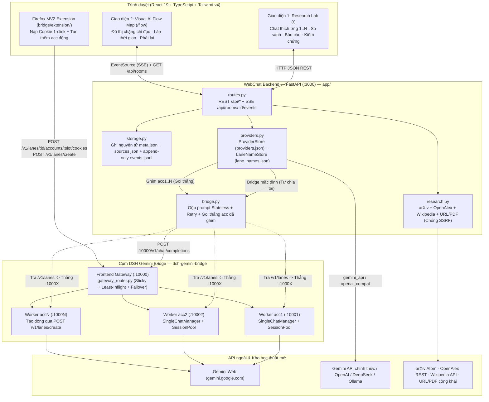
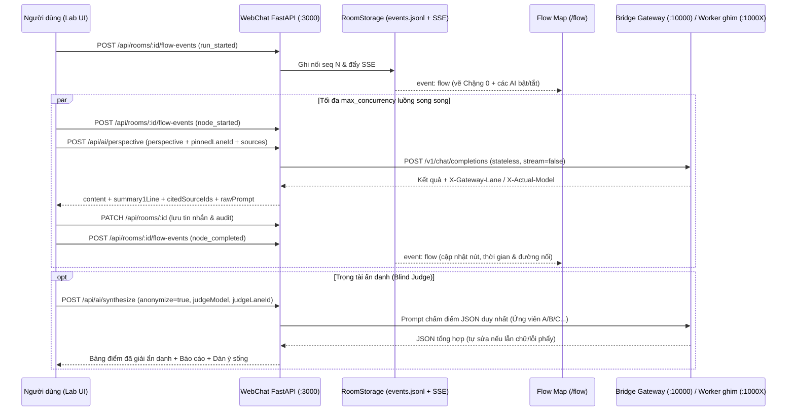

# Kiến trúc Hệ thống — Research AI Web

> 🌐 **Ngôn ngữ:** [English](ARCHITECTURE.md) | [한국어](ARCHITECTURE.ko.md) | **Tiếng Việt**
>
> 📚 **Tài liệu liên quan:** [README](../README.vi.md) · [Thuật toán & Bài nghiên cứu tham khảo](ALGORITHMS_AND_RESEARCH.vi.md)

Tài liệu này mô tả chi tiết kiến trúc đầu-cuối đã được kiểm chứng trong mã nguồn của **Research AI Web**, bao gồm giao diện React hai mặt phẳng tách biệt, backend điều phối FastAPI (`app/` & `src/`), cụm đa tài khoản **DSH Gemini Bridge** ([dsh-gemini-bridge](https://github.com/Khai-1711/dsh-gemini-bridge)), cơ chế lưu trữ theo dòng sự kiện (`events.jsonl` + SSE) và các ranh giới bảo mật.

---

## 1. Sơ đồ Kiến trúc Tổng thể



---

## 2. Kiến trúc 2 Giao diện Tách biệt (Zero-Coupling Frontend — `src/`)

Toàn bộ giao diện được biên dịch thành 1 gói Vite (`dist/`) do FastAPI (`app/main.py`) phục vụ, nhưng tách bạch hoàn toàn về luồng trạng thái và trách nhiệm (`App.tsx`):

| Khía cạnh | Giao diện 1: Research Lab (`/`) | Giao diện 2: Visual AI Flow Map (`/flow`) |
| :--- | :--- | :--- |
| **File chính** | `src/lab/ResearchLabApp.tsx`, `GroupFeed.tsx`, `Composer.tsx`, `LeftDrawer.tsx`, `RightDrawer.tsx`, `SettingsDrawer.tsx`, `SecondaryViews.tsx` | `src/flow/FlowMapApp.tsx`, `FlowCanvasSvg.tsx`, `SwimlaneView.tsx` |
| **Vai trò** | Đọc & thao tác: hỏi 1..N AI, gọi `@vai`/`@#nhóm`, chạy Phản biện chéo, Trọng tài ẩn danh, Deep Research, So sánh, Báo cáo, Kiểm chứng | Chỉ đọc (Read-only): quan sát trực quan đồ thị luồng thực thi, trục hội tụ, làn thời gian theo `acc1..accN`, tua lại từng bước |
| **Đồng bộ dữ liệu** | Lưu phòng qua `PATCH /api/rooms/{id}` và phát sự kiện vòng đời qua `POST /api/rooms/{id}/flow-events` | Chỉ lắng nghe `EventSource("/api/rooms/{id}/events")` (sự kiện `snapshot` & `flow`) |
| **Bộ nhớ trình duyệt** | `localStorage` **chỉ lưu tùy chọn nhẹ**: chủ đề Sáng/Tối, trạng thái đóng/mở bảng phụ, Preset và cấu hình luồng/Trọng tài | Đồng bộ chủ đề tức thì giữa các tab qua `window.addEventListener("storage")` |

---

## 3. Kiến trúc Backend WebChat (`app/`)

Backend gồm 7 module Python tách rõ trách nhiệm:

1. **`main.py`**: Khởi tạo ứng dụng (`create_app`), nối `RoomStorage`, `BridgeClient`, `ProviderStore`, gắn `/assets` từ `dist/` và trả SPA fallback cho `/` và `/flow`.
2. **`config.py`**: Dataclass `Settings` nạp từ `.env` (mặc định `PORT=3000`, `BRIDGE_URL=http://127.0.0.1:10000`, `DEFAULT_MODEL=gemini-4-hydrogen`, `BRIDGE_TIMEOUT_S=250.0`, `BRIDGE_MAX_RETRIES=2`).
3. **`storage.py` (`RoomStorage`)**:
   - Lưu từng phòng bền vững trên đĩa tại `data/rooms/<room_id>/`:
     - `meta.json` (ghi nguyên tử qua file tạm + `os.replace`): tiêu đề, danh sách góc nhìn, tin nhắn, dàn ý sống, báo cáo, nhật ký kiểm chứng.
     - `sources.json` (ghi nguyên tử): danh sách nguồn dẫn chứng `[S1]..[Sk]`.
     - `events.jsonl` (NDJSON chỉ ghi nối thêm): chuỗi sự kiện đồ thị có số thứ tự `seq` tăng đơn điệu.
   - Duy trì hàng đợi `asyncio.Queue` theo từng `room_id` để đẩy SSE thời gian thực kèm nhịp giữ kết nối `: ping` mỗi `20s`.
   - Khi `data/rooms/` trống hoàn toàn, `ensure_default_room()` chỉ tạo duy nhất 1 phòng trống sạch (`room-default`), không chèn hội thoại mẫu.
4. **`providers.py` (`ProviderStore` & `LaneNameStore`)**:
   - Quản lý nguồn `bridge-local` mặc định và các nguồn `bridge`, `gemini_api`, `openai_compat` do người dùng nạp trong `data/providers.json`.
   - Che toàn bộ API key (`mask_secret`: `AIza...9x2Q`) trong mọi phản hồi API ra giao diện.
   - Tự truy vấn danh sách model thật từ `GET :10000/v1/models` ghép cùng các provider ngoài (`GET /api/models`).
   - Lưu tên gợi nhớ tự đặt của người dùng cho từng `acc1`, `acc2`, `acc3` vào `data/lane_names.json` mà không chỉnh sửa file `.env.acc*` chứa cookie.
5. **`bridge.py` (`BridgeClient`)**:
   - **Gộp 1 tin nhắn User không trạng thái (`compile_stateless_user_prompt`)**: Gộp `system_instruction` + `user_prompt` vào 1 tin nhắn `role: "user"` với `stream: false` (vì Gemini Web bỏ qua `role: "system"` và tắt stream giữ nguyên cơ chế failover `429`/`503` của Gateway).
   - **Hai chế độ định tuyến**:
     - *Tự động (`pinned_lane_id` trống)*: Gửi qua Gateway `:10000/v1/chat/completions`, đọc các header `X-Gateway-Lane`, `X-Actual-Model`, `X-Fallback-From`.
     - *Ghim cứng tài khoản (`pinned_lane_id = "accX"`)*: Tra URL cục bộ của `accX` qua Gateway `GET /v1/lanes`, kiểm tra `_is_loopback_url()`, báo lỗi rõ (`HTTP 502`) nếu acc đang TẮT/mất kết nối (tuyệt đối không tự nhảy âm thầm sang acc khác), và gửi thẳng tới `http://127.0.0.1:1000X/v1/chat/completions`.
   - **Retry & Fallback chịu lỗi**: Lùi thời gian theo hàm mũ có tôn trọng `Retry-After` với mã `{408, 429, 500, 502, 503, 504}`; tự đổi sang `"auto"` nếu gặp `400 model_not_available`.
6. **`research.py`**: Tìm kiếm học thuật mở song song (`asyncio.gather`) trên arXiv Atom XML, OpenAlex Works API (tái dựng abstract từ chỉ mục đảo ngược), Wikipedia Search API, cùng trích xuất URL/PDF (`pypdf`, giới hạn 5 MB, 4 trang đầu) có bảo vệ chống SSRF.
7. **`routes.py`**: Định nghĩa toàn bộ REST/SSE API, dựng prompt từng góc nhìn, lọc mã trích dẫn `[S#]` hợp lệ và tổng hợp Trọng tài ẩn danh.

---

## 4. Luồng Dữ liệu Đầu-Cuối



---

## 5. Cụm DSH Gemini Bridge ([dsh-gemini-bridge](https://github.com/Khai-1711/dsh-gemini-bridge))

Phân hệ Bridge biến các phiên đăng nhập Gemini Web thành cụm worker chuẩn OpenAI:

- **Frontend Gateway (`bridge/main.py`, `app/gateway_router.py`)**:
  - Tự kích hoạt trên cổng `10000` khi có `PEER_LANES` (`acc1=http://127.0.0.1:10001`, `acc2=…`, `acc3=…`).
  - Hợp nhất `/v1/models` từ các worker khỏe và định tuyến `/v1/chat/completions` bằng Sticky + Least-Inflight kèm cooldown `15s` khi lỗi.
  - Cung cấp endpoint nội bộ `POST /v1/lanes/create` (`_create_lane_lock`) để tự sinh `.env.accN`, cập nhật `PEER_LANES`, đăng ký peer, khởi chạy tiến trình worker và kiểm tra sẵn sàng.
- **Worker Runtime (`app/gemini_runtime.py`, `app/session_pool.py`, `app/account_pool.py`, `app/gemini_session.py`)**:
  - **Lớp con `GeminiClient` chống tự khóa chết (`app/gemini_session.py`)**: Phát hiện sớm chuyển hướng đăng nhập (`boq_identityfrontendauthuiserver`) trước khi gọi RPC, tắt đệ quy `@running` trong lúc `init()` (`current_retry=0, close_on_error=False`) để triệt tiêu deadlock trên `self._lock`, tự dọn cache cookie hỏng và dò cookie preflight.
  - **Lưu bền bộ cookie phụ**: Ghi đủ cookie phiên trình duyệt (`SID`, `HSID`, `SSID`, `__Secure-1PSIDCC`…) vào `.gemini_cookies_acc*/extra_cookies_slot{slot}.json` để giữ đăng nhập qua lần khởi động lại.
  - **Bảo vệ vòng lặp sự kiện Windows (`bridge/main.py`)**: Ép Uvicorn dùng `asyncio.SelectorEventLoop` trên Windows để `curl_cffi` (`add_reader`/`add_writer`) không bị treo trên `ProactorEventLoop`.
  - **Session Pool & Tool Parser**: Cô lập tối đa 16 ngăn phiên song song (`SESSION_POOL_TTL=3600s`) và áp dụng parse `<tool_call>` theo nguyên tắc fail-closed khi kết nối coding agent.

---

## 6. Hợp đồng Dữ liệu Sự kiện (`events.jsonl`)

Mỗi dòng trong `events.jsonl` khai báo tường minh danh sách cạnh đầu vào (`inputs[]`), giúp `/flow` tự dựng đồ thị cho mọi kịch bản thực tế mà không cần hardcode luồng:

```json
{
  "seq": 4,
  "event_type": "node_completed",
  "run_id": "run-1795276408523",
  "room_id": "room-1795276408523",
  "timestamp": "2026-11-21T15:53:58.695Z",
  "payload": {
    "node_id": "stage1_p-research-1_run-1795276408523",
    "stage_index": 1,
    "stage_label": "Vòng 0 · Trả lời độc lập (1)",
    "actor": { "id": "p-research-1", "handle": "Nghiên_cứu", "kind": "ai", "enabled": true },
    "inputs": [
      { "from_node_id": "stage0_user_run-1795276408523", "kind": "prompt", "chars": 13, "source_ids": [] }
    ],
    "summary_1line": "...",
    "transport": { "lane_id": "acc1", "started_offset_s": 0.1, "elapsed_s": 14.0 }
  }
}
```

---

## 7. Ranh giới Bảo mật

1. **Tách biệt bí mật**: Cookie chỉ nằm trong `bridge/.env.acc*` và `bridge/.gemini_cookies_acc*/`; API key chỉ lưu trong `data/providers.json`. Tất cả bị chặn bởi `.gitignore` và không bao giờ ghi log dạng thô.
2. **Chống SSRF (`app/research.py`)**: Chặn giao thức ngoài HTTP(S), chặn IP loopback/nội bộ/link-local và tên miền `.local`/`.internal`, kiểm tra kết quả DNS trước khi tải, tắt tự động redirect (`follow_redirects=False`) để kiểm tra lại địa chỉ `Location`.
3. **Kiểm tra Origin & Loopback (`bridge/app/control.py`, `bridge/app/lane_security.py`, `app/bridge.py`)**: Xác thực `Host`/`Origin` trên API điều khiển Bridge, chỉ mở CORS extension trên loopback, và khóa địa chỉ gọi thẳng khi ghim acc về đúng phạm vi loopback.
4. **Định tuyến ghim fail-closed**: Nếu ghim một AI vào acc đang TẮT hoặc mất kết nối, hệ thống trả lỗi `HTTP 502` rõ ràng thay vì tự âm thầm chạy sang tài khoản Google khác.
