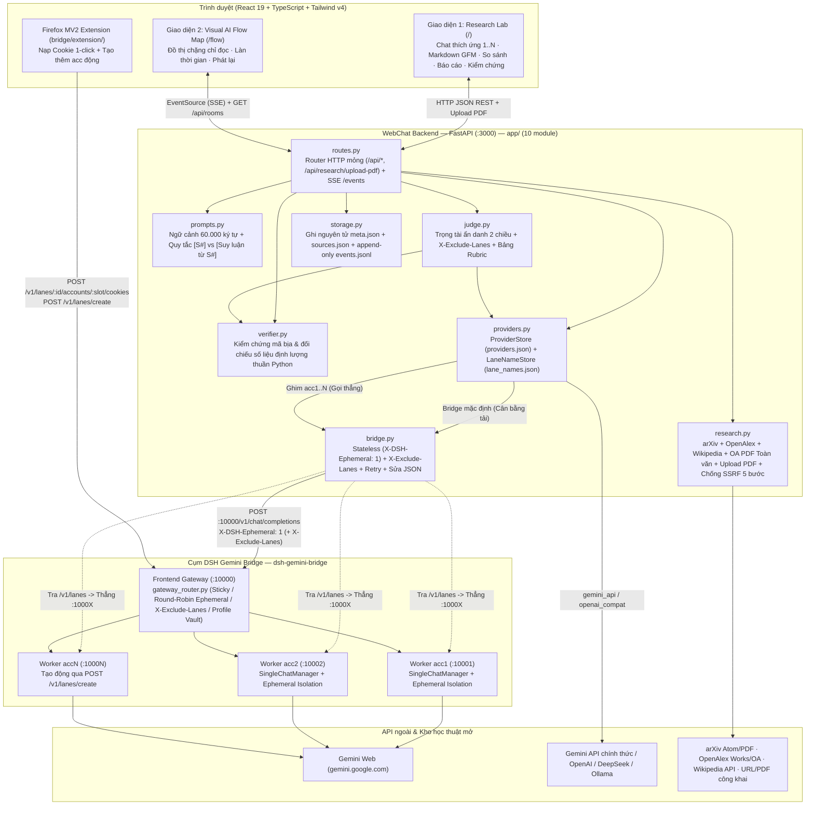
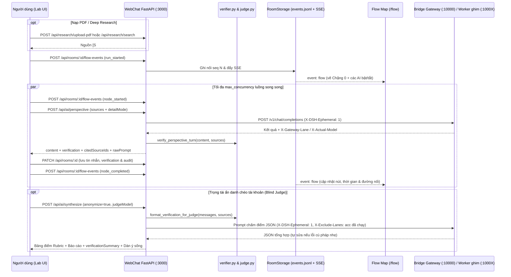

# Kiến trúc Hệ thống — Research AI Web

> 🌐 **Ngôn ngữ:** [English](ARCHITECTURE.md) | [한국어](ARCHITECTURE.ko.md) | **Tiếng Việt**
>
> 📚 **Tài liệu liên quan:** [README](../README.vi.md) · [Thuật toán & Bài nghiên cứu tham khảo](ALGORITHMS_AND_RESEARCH.vi.md)

Tài liệu này mô tả chi tiết kiến trúc đầu-cuối đã được kiểm chứng trong mã nguồn của **Research AI Web**, bao gồm giao diện React hai mặt phẳng tách biệt (`src/`), 10 module backend FastAPI đơn nhiệm vụ (`app/`), cụm đa tài khoản **DSH Gemini Bridge** ([dsh-gemini-bridge](https://github.com/Khai-1711/dsh-gemini-bridge)), tầng kiểm chứng trích dẫn/số liệu tất định, cơ chế lưu trữ theo dòng sự kiện (`events.jsonl` + SSE) và các ranh giới bảo mật.

---

## 1. Sơ đồ Kiến trúc Tổng thể



---

## 2. Kiến trúc 2 Giao diện Tách biệt (Zero-Coupling Frontend — `src/`)

Toàn bộ giao diện được biên dịch thành 1 gói Vite (`dist/`) do FastAPI (`app/main.py`) phục vụ, nhưng tách bạch hoàn toàn về luồng trạng thái và trách nhiệm (`App.tsx`):

| Khía cạnh | Giao diện 1: Research Lab (`/`) | Giao diện 2: Visual AI Flow Map (`/flow`) |
| :--- | :--- | :--- |
| **File chính** | `src/lab/ResearchLabApp.tsx`, `GroupFeed.tsx`, `MarkdownText.tsx`, `Composer.tsx`, `LeftDrawer.tsx`, `RightDrawer.tsx`, `SettingsDrawer.tsx`, `SecondaryViews.tsx` | `src/flow/FlowMapApp.tsx`, `FlowCanvasSvg.tsx`, `SwimlaneView.tsx` |
| **Vai trò** | Đọc & thao tác: hỏi 1..N AI, gọi `@vai`/`@#nhóm`, nạp PDF cục bộ/URL, chạy Deep Research, Phản biện chéo, Trọng tài ẩn danh, So sánh, Báo cáo, Kiểm chứng | Chỉ đọc (Read-only): quan sát trực quan đồ thị luồng thực thi, trục hội tụ, làn thời gian theo `acc1..accN`, tua lại từng bước |
| **Đồng bộ dữ liệu** | Lưu phòng qua `PATCH /api/rooms/{id}` và phát sự kiện vòng đời qua `POST /api/rooms/{id}/flow-events` | Chỉ lắng nghe `EventSource("/api/rooms/{id}/events")` (sự kiện `snapshot` & `flow`) |
| **Bộ nhớ trình duyệt** | `localStorage` **chỉ lưu tùy chọn nhẹ**: chủ đề Sáng/Tối, trạng thái đóng/mở bảng phụ, Preset và cấu hình luồng/Trọng tài | Đồng bộ chủ đề tức thì giữa các tab qua `window.addEventListener("storage")` |

---

## 3. Kiến trúc Backend WebChat (`app/` — 10 Module Đơn Nhiệm Vụ)

Backend được tách thành 10 module Python độc lập, dễ kiểm soát và kiểm thử riêng từng tầng:

1. **`main.py`**: Khởi tạo ứng dụng (`create_app`), nối `RoomStorage`, `BridgeClient`, `ProviderStore`, gắn `/assets` từ `dist/` và trả SPA fallback cho `/` và `/flow`.
2. **`config.py`**: Dataclass `Settings` nạp từ `.env` (mặc định `PORT=3000`, `BRIDGE_URL=http://127.0.0.1:10000`, `DEFAULT_MODEL=gemini-4-hydrogen`, `BRIDGE_TIMEOUT_S=250.0`, `BRIDGE_MAX_RETRIES=2`).
3. **`storage.py` (`RoomStorage`)**:
   - Lưu từng phòng bền vững trên đĩa tại `data/rooms/<room_id>/`: `meta.json` (ghi nguyên tử qua `os.replace`), `sources.json` (kho nguồn `[S1]..[Sk]`), và `events.jsonl` (NDJSON chỉ ghi nối thêm với `seq` tăng đơn điệu).
   - Duy trì hàng đợi `asyncio.Queue` theo từng `room_id` để đẩy SSE kèm nhịp `: ping` mỗi `20s`.
   - Khi `data/rooms/` trống, `ensure_default_room()` chỉ tạo duy nhất 1 phòng trống sạch (`room-default`).
4. **`providers.py` (`ProviderStore` & `LaneNameStore`)**:
   - Quản lý nguồn `bridge-local`, `bridge`, `gemini_api`, `openai_compat` trong `data/providers.json`; che toàn bộ API key (`mask_secret`: `AIza...9x2Q`).
   - Truyền `exclude_lanes` tới `BridgeClient.chat_stateless`; quản lý tên gợi nhớ cho `acc1..accN` tại `data/lane_names.json`.
5. **`bridge.py` (`BridgeClient`)**:
   - **Gọi phi trạng thái cô lập (`X-DSH-Ephemeral: 1`)**: Gộp `system_instruction` + `user_prompt` vào 1 tin nhắn `role: "user"`, gắn `X-DSH-Ephemeral: 1` (để Bridge không ghi đè phiên chat, model mặc định hay handoff ledger) và `X-Exclude-Lanes` (khi Trọng tài cần tránh các acc vừa tranh luận).
   - **Hai chế độ định tuyến**: Tự động cân bằng tải qua Gateway `:10000` (đọc `X-Gateway-Lane`, `X-Actual-Model`, `X-Fallback-From`), hoặc **Ghim cứng tài khoản (`pinned_lane_id`)** kiểm tra `_is_loopback_url()` và fail-closed (`HTTP 502`) nếu acc đang TẮT.
   - **Proxy Profile Vault**: Chuyển tiếp các lệnh tạo luồng động (`/v1/lanes/create`), đăng nhập 1 lần (`/{id}/login`, `/{id}/finish-login`) và sync ngầm (`/{id}/sync`, `/sync-all`).
   - **Retry & JSON Repair**: Backoff hàm mũ tôn trọng `Retry-After` cho `{408, 429, 500, 502, 503, 504}`; phân tách và sửa JSON cân bằng ngoặc có `json_repair`.
6. **`research.py`**:
   - Truy vấn song song arXiv Atom XML, OpenAlex Works API (tái dựng abstract từ chỉ mục đảo ngược) và Wikipedia Search API (`asyncio.gather`), tự động nâng cấp tối đa 3 nguồn mở (arXiv / OpenAlex OA) lên **Toàn văn PDF** (tới 20 trang, `MAX_FULLTEXT_EXCERPT_LEN = 16000`).
   - Hỗ trợ đọc tệp `.pdf` tải lên từ máy (`extract_uploaded_pdf_source`, tối đa `15 MB`, `25` trang) và tải URL/PDF qua `_safe_get_following_redirects` (kiểm tra SSRF ở từng bước chuyển hướng tối đa `5` hop).
   - Gắn nhãn trung thực `contentLevel` (`full_text` | `abstract_only` | `excerpt`) và `charCount`.
7. **`prompts.py`**:
   - Quản lý ngân sách ngữ cảnh: chế độ Tiêu chuẩn (`MAX_HISTORY_CHARS = 8000`, `MAX_PERSPECTIVE_SOURCE_CHARS = 3000`) và chế độ Chuyên sâu (`MAX_DEEP_HISTORY_CHARS = 60000`, `MAX_PRESERVED_RESEARCH_CHARS = 16000`, `MAX_PERSPECTIVE_SOURCE_CHARS_DEEP = 12000`).
   - Ép quy tắc trích dẫn tách bạch `[S#]` (trực tiếp từ nguồn) và `[Suy luận từ S#]` (tính toán/suy diễn), đồng thời gắn thẻ `[TOÀN VĂN]` / `[CHỈ CÓ TÓM TẮT (ABSTRACT)]` cho từng nguồn.
8. **`verifier.py`**:
   - Bộ kiểm chứng tất định thuần Python (`verify_perspective_turn`, `format_verification_for_judge`): phân loại `validCitations`, `inferredCitations`, `invalidCitations` (mã bịa), `abstractOnlyCited`, và đối chiếu các số liệu định lượng (`%`, số thập phân, cỡ mẫu `n=...`) trong câu gắn `[S#]` trực tiếp với văn bản gốc của nguồn được trích.
9. **`judge.py`**:
   - Ánh xạ ẩn danh 2 chiều (`@handle ↔ Ứng viên A/B/C…`), thu thập `used_lanes` từ các lượt tranh luận để gửi `X-Exclude-Lanes` sang Bridge, nhúng biên bản đối chiếu từ `verifier.py` vào prompt Trọng tài (giới hạn `MAX_JUDGE_SOURCE_EXCERPT = 6000` ký tự/nguồn), tính Rubric 3 trục và gắn cờ `fallbackScored` nếu Trọng tài không trả đủ điểm JSON.
10. **`routes.py`**: Router FastAPI mỏng cung cấp `/api/health`, `/api/lanes/*`, `/api/providers/*`, `/api/models`, `/api/rooms/*`, `/api/research/search`, `/api/research/upload-pdf` (nhận nhị phân `application/pdf` hoặc JSON `contentBase64`), `/api/ai/perspective`, `/api/ai/synthesize`, và tái xuất các helper để tương thích ngược.

---

## 4. Luồng Dữ liệu Đầu-Cuối



---

## 5. Cụm DSH Gemini Bridge ([dsh-gemini-bridge](https://github.com/Khai-1711/dsh-gemini-bridge))

Phân hệ Bridge biến các phiên đăng nhập Gemini Web thành cụm worker chuẩn OpenAI (chạy song song cục bộ khi kết nối từ Research AI Web):

- **Frontend Gateway (`bridge/main.py`, `app/gateway_router.py`)**: Điều phối Sticky + Least-Inflight cho hội thoại dài, Round-Robin công bằng khi có header `X-DSH-Ephemeral: 1`, ưu tiên tránh danh sách `X-Exclude-Lanes`, hỗ trợ cooldown `15s` khi lỗi và proxy quản lý Profile Vault / tạo luồng động.
- **Worker Runtime (`app/gemini_runtime.py`, `app/session_pool.py`, `app/account_pool.py`, `app/gemini_session.py`, `app/streaming.py`)**:
  - Cô lập hoàn toàn các lượt `X-DSH-Ephemeral: 1` (không dùng lại `chat_session`, không đụng `FactLedger` bền vững, không thay đổi `default_model`, không kẹp `[GOAL]`/`_pending_handoff` và không ép tái tạo lại lượt).
  - Lớp `GeminiClient` chống self-deadlock khi `init()`, dọn thẻ UI XML nội bộ của Gemini Web (`<ElicitationsGroup>`, `<Elicitation>`) ở tầng stream (`streaming.py`) mà vẫn bảo toàn `<tool_call>` JSON.

---

## 6. Hợp đồng Dữ liệu Sự kiện (`events.jsonl`)

Mỗi dòng trong `events.jsonl` khai báo tường minh danh sách cạnh đầu vào (`inputs[]`), giúp `/flow` tự dựng đồ thị cho mọi kịch bản thực tế mà không cần hardcode luồng:

```json
{
  "seq": 4,
  "event_type": "node_completed",
  "run_id": "run-1795276408523",
  "room_id": "room-1795276408523",
  "timestamp": "2026-11-21T15:53:58.695Z",
  "payload": {
    "node_id": "stage1_p-research-1_run-1795276408523",
    "stage_index": 1,
    "stage_label": "Vòng 0 · Trả lời độc lập (1)",
    "actor": { "id": "p-research-1", "handle": "Nghiên_cứu", "kind": "ai", "enabled": true },
    "inputs": [
      { "from_node_id": "stage0_user_run-1795276408523", "kind": "prompt", "chars": 13, "source_ids": [] }
    ],
    "summary_1line": "...",
    "transport": { "lane_id": "acc1", "started_offset_s": 0.1, "elapsed_s": 14.0 }
  }
}
```

---

## 7. Ranh giới Bảo mật

1. **Tách biệt bí mật**: Cookie chỉ nằm trong `bridge/.env.acc*` và `bridge/.gemini_cookies_acc*/`; API key chỉ lưu trong `data/providers.json`. Tất cả bị chặn bởi `.gitignore` và không bao giờ ghi log dạng thô.
2. **Chống SSRF 5 chặng (`app/research.py`)**: Chặn giao thức ngoài HTTP(S), chặn IP loopback/nội bộ/link-local và tên miền `.local`/`.internal`, kiểm tra DNS trước khi kết nối, tắt redirect tự động (`follow_redirects=False`) và kiểm tra lại địa chỉ `Location` tối đa 5 chặng chuyển hướng.
3. **Giới hạn Upload PDF an toàn (`app/routes.py`, `app/research.py`)**: Kiểm tra ngưỡng `15 MB`, kiểm tra header `%PDF-`, và từ chối sạch PDF quét ảnh không có văn bản OCR.
4. **Kiểm tra Origin & Loopback (`bridge/app/control.py`, `bridge/app/lane_security.py`, `app/bridge.py`)**: Xác thực `Host`/`Origin` trên API điều khiển Bridge và khóa địa chỉ gọi thẳng khi ghim acc về đúng phạm vi loopback.
5. **Định tuyến ghim fail-closed**: Nếu ghim một AI vào acc đang TẮT hoặc mất kết nối, hệ thống trả lỗi `HTTP 502` rõ ràng thay vì tự âm thầm chạy sang tài khoản Google khác.
